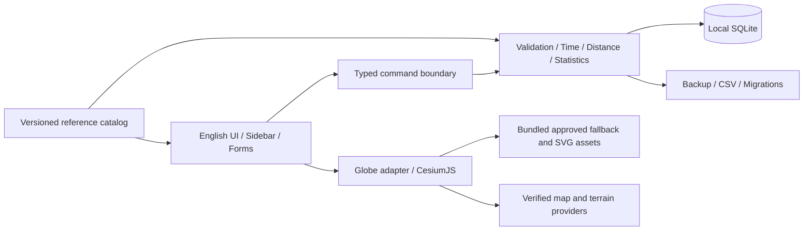

# 04 · 工程与架构规格

状态：已失效旧稿（未编号） · 方案为推荐基线，P0 验证后冻结。本文是实现规格，不包含代码。

## 1. 技术选型

| 层 | 推荐 | 理由与边界 |
| --- | --- | --- |
| 桌面外壳 | Tauri 2 | 系统 WebView，适合 Web UI + Rust 本地数据；Windows 使用 WebView2 |
| UI | React + TypeScript + Vite | 表单、可复用组件、成熟测试；依赖具体版本在 P0 记录 |
| 地球 | CesiumJS | 支持 WGS84 三维地球、地形、影像和地理对象；数据授权另算 |
| 本地服务 | Rust commands | 校验、时间/距离计算、SQLite、备份与文件操作的可信边界 |
| 数据库 | SQLite | 单用户事务和迁移，建议一个 Rust 数据访问层统一管理 |
| 字体 | Inter | OFL；保留许可和原版本 |
| 单元/交互测试 | Rust 测试 + Vitest/Testing Library | 聚焦时间、距离、迁移与用户流程 |
| 桌面测试 | Windows 自动化能力经 P0 验证 | 浏览器 E2E 不能替代真实桌面/安装包验证 |

不为了 CesiumJS 强制引入 Python 服务、远程数据库或账号系统。不要同时用前端 SQL 插件和 Rust 直接写同一个库形成两套业务规则。

备选：若系统 WebView2 的 GPU、资源协议或驱动兼容无法达标，可评估 Electron + 同一前端与 Cesium；若原生 Windows 控件是强要求，可用 WinUI 3 + WebView2，但仍需验证地图集成。换方案时交付对照、性能、包体和维护代价，记录 ADR。普通 Three.js 球体只可作为技术实验，不足以替代完整地理引擎。

## 2. 模块与边界

UI 不直接访问任意文件路径或执行 SQL。地球适配器接受已验证的坐标、route DTO 与选中状态，不保存业务数据。地图加载失败和 UI 业务状态独立。网络地图供应商只接收必要瓦片/地形请求，不接收个人航班数据库。

建议实现目录（本次不创建）：`src/features/flights`、`src/features/insights`、`src/features/settings`、`src/map`、`src/design`、`src-tauri/src/domain`、`src-tauri/src/storage`、`resources/catalog`、`resources/logos`、`tests`、`docs/implementation`、`docs/acceptance`。实际组织可以调整，但职责边界保持。

## 3. 数据模型

所有实体 UUID；时间 UTC ISO 8601 或明确整数时间戳；距离整数 m；经纬度十进制度并记录坐标基准。

| 实体 | 核心字段/关系 |
| --- | --- |
| Airport | id, official English name, city, lat/lon, coordinate_reference, type, operational_status, source, version |
| AirportIdentifier | airport_id, kind(IATA/ICAO/local), value, valid_from/to, source；明确城市代码不在机场选择集 |
| AirportTimeZone | airport_id, IANA zone, verification_source, confidence, effective interval |
| Airline | id, English name, aliases, status, source；不拿二字码当永久唯一键 |
| AirlineIdentifier | airline_id, IATA/ICAO, value, valid_from/to |
| Alliance | id, name, logo_asset_id |
| AllianceMembership | airline_id, alliance_id, status, valid_from/to, evidence_url, verified_at；有效期间可未知 |
| AircraftType | id, manufacturer, family, model, ICAO type(optional verified), source；Unknown 为特殊选项 |
| Flight | id, operating/marketing airline IDs, number, airport IDs, both local datetimes/zones/offsets/UTC, time_basis, type, distances, notes, timestamps |
| FlightSnapshot | flight_id, frozen display names/codes/coordinates/alliance result, catalog/tzdb/calculation versions |
| Asset | id, entity link, local path, source/revision, license, trademark notes, attribution, hash, review status |
| CatalogRelease | id, published_at, source_versions, counts, coverage, hashes, validated_at |
| Preference | schema version, theme, units, sidebar state/width, provider choice, view preferences |
| Migration | schema version, applied_at, previous backup path and outcome |

删除航班使用 deleted_at；永久清理在事务内。目录实体被航班引用后不物理删除，改用停用状态。自定义实体与标准实体分类明确，外部更新不会覆盖自定义内容。

索引至少覆盖 departure_utc、operating_airline_id、起降 airport_id、deleted_at 和规范化检索字段。文本检索采用索引或本地全文方案；备注进入检索但日志不输出其原文。

## 4. 时间与距离实现约束

Rust 核心统一生成有效 UTC、offset 和 duration；前端预览与后端采用相同规则。使用能够读取并固定 IANA tzdb 的实现，不能仅依赖不易固定版本的 WebView Intl 做全部持久化转换。存 local+zone+offset+UTC+tzdb version，tzdb 更新后不自动重新解释旧航班；编辑时间时明确重算。

机场改动使默认时区改变，表单标记需重新确认。历史区域时区映射不能按“国家一个时区”生成。坐标映射得到候选后仍需来源/人工核验，OurAirports 本身不是完整时区来源。

计算距离采用对近对跖点稳定的 WGS84 椭球算法，例如 GeographicLib 系列实现；具体库需实现 Agent 核验许可证、版本和边界测试。地球视觉曲线可在椭球地理路径上叠加视觉高度，不能修改统计距离。

## 5. command 契约与错误模型

| 命令组 | 输入/输出职责 |
| --- | --- |
| search_reference | 类型、查询、上限；返回实体 ID、展示字段和来源状态 |
| preview_flight | 草稿；返回 UTC 候选、时长、计算距离、警告和逐字段错误 |
| create/update_flight | 已确认草稿及修改版本；后端再次校验并事务提交，返回完整 DTO |
| list/get_flights | 分页、排序、筛选；返回列表/详情及匹配数量 |
| trash/restore/purge | 记录 ID；更改删除状态或明确永久删除 |
| get_summary/get_routes | 同一 filter DTO；返回按固定口径计算的摘要和路线组 |
| export_backup/export_csv | 用户选定位置；返回已写入文件与数量，不接受任意内部命令 |
| preview_import/commit_import | 文件/预览确认令牌；解析结果、冲突决策、原子提交报告 |
| get/update_preferences | 白名单设置；返回保存后状态 |
| validate/update_catalog | 已准备好的版本包；hash、schema、许可和完整性通过后才替换 |

统一错误包含稳定 code、英语用户消息、可选 field 和 retryable。代码至少包含 VALIDATION_ERROR、AMBIGUOUS_LOCAL_TIME、NONEXISTENT_LOCAL_TIME、STORAGE_FULL、DATABASE_UNAVAILABLE、IMPORT_INVALID、IMPORT_CONFLICT、MAP_UNAVAILABLE。敏感输入不写入日志；意外错误保留关联 ID 方便查找脱敏日志。

编辑采用 updated_at/版本号检查，防止两个窗口或重复保存覆盖；旧稿 可以只允许一个主窗口，但仍需防双击重复提交。

## 6. 文件、备份和导入

用户数据建议 `%LOCALAPPDATA%/AirJourney/`，包含 database、backups、logs、settings；安装与项目目录不得承载运行时数据库。用户选择导出位置。Windows ACL 默认遵从当前用户；旧稿 不承诺额外数据库加密，备份应提示含个人旅程数据。

JSON 备份包含 format_version、app_version、exported_at、catalog references、flights、snapshots、custom entities、settings 可选和回收站可选。地图服务密钥、瓦片缓存和内部日志不得进入备份。拒绝更高且不支持的版本；缺少必需字段、非法坐标/时间逐行报告。

导入先预览，默认 merge by UUID：完全一致跳过；同 ID 内容不同要求 keep existing / replace；不同 ID 的相似航班仅提示重复，可保留两条。导入前创建恢复副本，commit 为单事务；部分无效数据由用户明确选择只导入已通过记录，否则不提交。操作中断回滚，取消预览不改变数据库。

CSV 仅供可读导出，含双端本地日期时间、时区、UTC、机型、两种距离和状态。遵守引号/换行转义，对以 =、+、-、@ 等开头的文本做电子表格公式注入防护并记录策略；CSV 不作为完整恢复格式。

SQLite 在线一致备份使用专用 backup API 或明确一致性机制，不直接复制仍在写入的 WAL 数据库。迁移失败返回旧版本/只读恢复选项，禁止自动删库重建。

## 7. 地球性能与降级

初始化只创建一个 viewer；React render 不重建 globe。所有 route 采用批量更新，静止时按需渲染；窗口 resize 和 DPI 改变独立处理。相同线路聚合、标签按距离控制、机场聚类、索引拾取。筛选后回收无用几何资源，避免累计监听器。

正常模式加载已核验地形与影像；断网模式用授权本地低分辨率底图和椭球，保留路线并显示 Reduced map detail。这是异常状态，不代表最终旧稿范围 的地形要求已经满足。GPU/context loss 提供重试与可用列表；可显示静态示意，但不能以此通过正常模式的三维验收。

## 8. 安全、构建与发布

启用最小 Tauri capabilities、CSP、网络域白名单、参数化 SQL、路径校验。SVG 清除脚本、外部 URL、foreignObject 和潜在危险内容后渲染；保留正确 viewBox 与品牌色。地图 token 只给必要权限，额度与域限制是否适用桌面 origin 需验证，不能把服务端秘密放包内。

锁定依赖和 catalog 版本，生成第三方许可清单。Cesium Workers、Assets、Widgets 等本地资源路径必须在安装包里可用；不能只在开发服务器上测试。Windows 安装优先 per-user NSIS，支持 WebView2 在线引导及离线部署说明；MSIX/商店作为后续候选。签名凭据由负责人提供，未经授权不申请付费签名。

交付包附构建环境、版本/hash、安装说明、数据位置、已知限制、升级回滚方案和实际测试结果。CI 中可跑领域测试和构建；GPU 与安装验收必须在真实 Windows 环境补齐。

