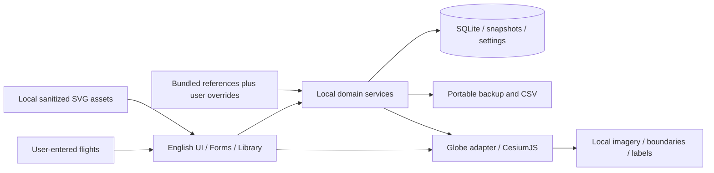

# 04 · 本地工程与实现规格

基线：v0.0 · 仅规划，不含实际代码或项目脚手架。

目标 App 对外显示版本为 v0.0；若构建工具要求三段数字，包元数据使用 0.0.0 表达同一版本，不视为一次迭代。后续升级由负责人决定，内部实现阶段不自动修改版本。

## 1. 最小架构

建议 Tauri 2、React/TypeScript、CesiumJS、Rust/SQLite。所有生产资源本地打包/导入，Rust 处理业务校验、存储、计算和文件。无需后台服务器、地图 API 账号、航班数据 SDK 或采集服务。

最终技术版本经实验冻结；若 Tauri 的本地资源协议与 Workers/GPU 无法达标，可评估 Electron 同一前端。替换不增加网络依赖，需实测而非泛泛比较技术品牌。

## 2. 离线地球设计

- Cesium viewer 明确禁用默认联网底图、ion 内容/服务、在线 geocoder、在线底图选择器、在线 terrain。不要只“不填 token”却仍调用默认网络服务。
- 生产使用本地图片或低级别本地瓦片；优先验证 4K 自然色/晕渲图，显存不足用 2K fallback。若单图清晰度/加载效率不足再用本地层级瓦片，不下载全球高 zoom 瓦片库。
- 地球表面首版用 WGS84 椭球；晕渲是影像视觉，不是高程。单图 equirectangular 的经纬度范围、像素方向和矩形范围必须正确；图层资源声明投影。最终缩放下限跟随纹理可辨尺度。
- 本地英语标签与已有图层独立显示；机场点和路线源于用户资料，检查显示、开关和联动效果。
- Workers、Assets、Widgets、字体、贴图、标签数据、本地 SVG 全打包；从干净用户环境测试，不依赖开发服务器、网络 CDN 或以前运行留下的缓存。
- 默认无外部连接；必要的内部 app 资源 URL/loopback 不等于外网访问，测试时分别记录。生产尽量用受限本地资源协议而非开放监听服务。

## 3. 数据来源与覆盖模型

保存用户原始输入，与目录建议、用户覆盖和计算值分开。外部资源只在开发阶段准备，应用使用 bundled reference + user overrides + flight snapshots。

| 层 | 用途 | 优先级 |
| --- | --- | --- |
| Bundled base | 只读起步机场/航司/联盟/机型与 SVG | 默认建议 |
| User library | 用户自定义实体及基础实体覆盖 | 高于默认 |
| Flight snapshot | 本条记录选择时的名称/坐标/时区/联盟/Logo 引用 | 历史显示和路线的实际输入 |
| Flight overrides | 本段独立样式、用户改时间/距离/名称 | 本条最高 |
| Derived values | UTC、时长、估算距离和路线几何 | 可重建，有 version/status |

没有为了“保持实时准确”而自动修改用户内容的流程。手动导入新参考包也默认不改 Flight snapshot。

## 4. 领域实体

| 实体 | 关键字段 |
| --- | --- |
| Airport/Place | UUID、name/city/display_region、aliases、optional codes(kind/value)、nullable WGS84 coordinates、optional IANA/offset、source_type |
| Airline | UUID、name/aliases/optional codes、alliance suggestion、logo_asset_id、display_color、hidden、base_entity_id |
| Alliance | UUID、name、SVG reference、source_type、hidden |
| AircraftType | UUID、manufacturer/family/model/optional type code、source_type、hidden |
| Flight | UUID、raw number、status、endpoint references/snapshots、nullable airline/aircraft、two date/time/zone specs、recorded distance/duration、notes、deleted_at |
| TimeSpec | precision(unknown/date/date_time)、date/time、zone_kind(IANA/offset/unknown)、zone/offset、resolved UTC、resolution_status、tzdb version |
| FlightSnapshot | 两端名称/代码/坐标/时区、航司/联盟名与 SVG 引用、机型；不因目录编辑静默变化 |
| DerivedFlight | geometry_status、distance_m/status、duration_seconds/status、algorithm_version；null 是未知而非 0 |
| Tag / FlightTag | UUID、用户名称、颜色、关联 |
| CustomFieldDefinition | UUID、label、type(text/number/date/select)、options、order、hidden、version |
| CustomFieldValue | flight_id、field_id、typed value、raw/archived value；不依赖字段名称作为键 |
| Asset | UUID、file path、hash、license/source、type、sanitization status、ownership、reference counts |
| MapPackage | version、projection、extent、local imagery/optional layers/labels、source/license、hashes、detail limit |
| Preference | theme/accent/density、units/date/clock、global route style、sidebar/camera、schema version |

稳定 ID 不用航班号或航司代码。自定义实体可以没有官方代码；用户代码和官方 IATA/ICAO 类型区分，避免错误的“标准”标记。机场坐标维持 optional，Null 与合法零坐标区分。

基于 SQLite 的索引覆盖 deleted_at/status、出发日期、endpoint IDs、航司和标签；不为了个人目录建设服务端搜索集群。

## 5. 本地业务服务契约

| 服务组 | 责任 |
| --- | --- |
| flight CRUD/duplicate/trash | 校验可存格式；保留不完整值；事务提交；新 ID 复制 |
| reference search/edit/hide/reset | 基础和用户层解析、可见候选、保留引用，不联网 |
| preview/apply reference change | 列受影响字段/记录；确认后批量更新快照和派生值 |
| resolve time | 提供 UTC/offset 候选与状态；不强制用户精确时间 |
| derive route/distance/summary | 根据可用数据生成，不猜未知；已显示/隐藏/待定位计数 |
| asset import/remove | 本地导入、显示预览、保存和引用管理 |
| custom fields/tags | 定义与值维护，类型迁移/隐藏有预览 |
| settings/map style | 设置取值校验、即时应用、保存和 reset |
| backup/export/preview import/commit | 完整数据与个人文件、冲突、hash、事务、可回滚 |

前端不直接执行 SQL 或任意文件操作。提交成功后才显示 Saved；失败保留草稿。错误使用稳定 code + 英语 message + 可选 field，至少 VALIDATION_ERROR、STORAGE_FULL、IMPORT_INVALID、ASSET_REJECTED、MAP_RESOURCE_MISSING。时间未知/待核对属于正常状态而不是数据库错误。

## 6. 时间、距离与路线算法

日期-only 留为日期，不生成 UTC。IANA 支持历史 DST 本地计算，无机场映射时用户可选区域/offset；本地规则固定版本。精确时间遇到 DST 或先后异常，保存 raw 与 unresolved status，允许继续录入并以后修正。手填 duration 单独保存 Manual，统计优先明确的手填值，再有效自动值。

距离使用稳定的 WGS84 椭球测地算法，避免近对跖点数值失败。人工距离保留原数字+单位，规范化 m 用于汇总。路线沿地理路径采样加可调视觉拱高；跨反子午线不平面插值。对几乎重合/对跖端点使用稳定几何策略，不能输出 NaN；拱高只是观感，不宣称实际高度。

single viewer + 批量 geometry，按需渲染；相同路线聚合、标签依距离控制。状态包括 mapped、unlocated、user_hidden、renderer_unavailable。只有 mapped 可见不代表其他记录被丢失。GPU 失败保持航班管理可用并提供错误说明/重试，不靠网络解决。

## 7. 资料编辑与引用

修改资料先写用户层；快照更新必须 explicit apply。批量应用坐标后重新生成受影响几何/估算距离，人工距离不动；时区改变使相关自动时间状态重新预览，用户确认后应用。

旧 SVG 被快照引用时需保留 managed file。新 Logo 默认用于以后选择；历史记录可 Apply logo to existing flights。移除 library Logo 不立即删除其他记录仍引用的文件。真正无引用的资产可以在明确清理后回收。

自定义字段删除先隐藏定义，旧值保留；改类型不可静默丢数据，转换预览或生成新字段保留旧字段。纯文本内容按用户输入保存与展示。

## 8. 文件与便携备份

推荐 `%LOCALAPPDATA%/AirJourney/` 存 database、user-assets、backups、settings、logs；程序安装目录只读 bundled resources。项目源码统一 `C:/MyFile/Project/AirJourney`，运行数据与源码分开。用户可选导出目录，无需改 appData 路径作为首版高级功能。

便携备份推荐 `.airjourney` ZIP：`manifest.json`、`data.json`、`assets/`。包含航班/回收站可选、所有快照、用户资料覆盖、自定义字段/标签、个人 SVG、样式/设置及基础/map package 版本引用。不在备份复制默认地图包和全部默认资源，控制体积；用户导入的私人资源应完整包含，基础包缺失时提示安装本地匹配资源包。

为跨机器完整恢复：备份收集当前记录实际引用的 Logo 文件（含旧随包品牌），而不是仅记录不可迁移绝对路径；license/provenance 保留。字体和基础地图通过随包提供满足首次离线使用，无需备份重复内容。

导入检查正常文件格式和版本，先预览，再确认恢复；提交失败或用户取消时保留原记录。验收重点是正常备份往返和常见错误提示。

CSV 可读导出含当地日期/time_precision、时区/UTC（可空）、人工/计算距离、状态、自定义字段。引号/换行正确，字段内容可读；CSV 不承担 SVG 与完整设置恢复。参考资料本地 JSON/CSV 导入有映射预览，名称/坐标/代码格式检查，但不查询该机场/航司是否真实存在。

## 9. 实际运行与功能测试

当前实现采用Electron、React/TypeScript、CesiumJS和SQLite WASM，详见docs/implementation/architecture.md；原先Tauri/Rust为设计建议，不作为本轮否决条件。核对模块职责、数据流和持久化行为，以真实运行验证功能。

测试重点：手动/自定义/未知字段、基本时间距离、资料编辑、地球/路线/侧栏、SVG展示与导入、设置、重启保存、删除恢复和正常备份往返。运行现有构建与测试，并检查实际程序/安装包。高级矩阵和性能提升记录为建议；最终通过规则见07_ACCEPTANCE.md。

